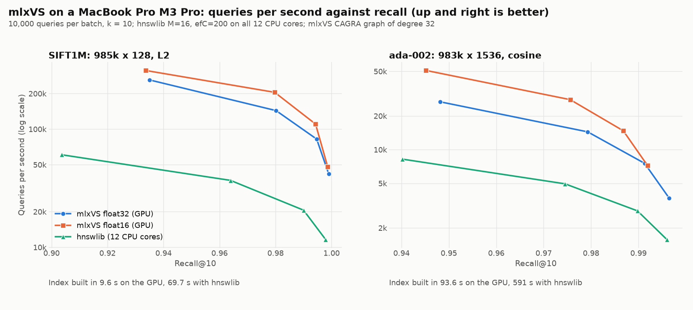

# mlxVS

**cuVS for your Mac: GPU vector search on Apple silicon.**

[](https://github.com/mikepapadim/mlxvs/actions/workflows/ci.yml)
[](LICENSE)

Index a million vectors in 11 seconds, then answer 76,000 queries per second at 97.6% recall, on a MacBook Pro's
GPU: 2.7 times the queries per second of HNSW on all 12 CPU cores at the same recall, from an index built 8 times
faster. On a million 1536-d OpenAI embeddings: built 6 times faster, twice the queries per second
([numbers](#benchmarks)). mlxVS brings NVIDIA [cuVS](https://github.com/rapidsai/cuvs)'s operations and parameter
names to the Mac, built on [MLX](https://github.com/ml-explore/mlx): exact k-NN, k-means, NN-Descent, batched
all-neighbors graphs, CAGRA graph pruning and search, and export to hnswlib. NumPy or MLX arrays in, any M-series Mac.

```python
import mlxvs
index = mlxvs.CagraIndex.build(vectors, graph_degree=32)   # 1M x 128 in ~10 s
ids, dist = index.search(queries, k=10)                     # ~143k queries/s at 98% recall
index.save("vectors.safetensors")
```

<picture>
  <source media="(prefers-color-scheme: dark)" srcset="https://raw.githubusercontent.com/mikepapadim/mlxvs/main/docs/img/bench-dark.png">
  
</picture>

Use it for approximate nearest-neighbor search, for the k-NN graph behind UMAP, t-SNE, clustering and
deduplication, for exact k-NN ground truth, or as the build step of a graph index (HNSW, Vamana, CAGRA).

## What's in it

| Function | What it does | cuVS counterpart |
|---|---|---|
| `brute_force_knn(base, queries, k)` | Exact k-NN: matrix multiply and a fused top-k kernel, tiled over the base | `brute_force::search` |
| `kmeans_fit(x, clusters)`, `kmeans_predict(x, centroids, m)` | k-means++ and Lloyd; the `m` nearest centroids per row | `cluster::kmeans` |
| `nn_descent(rows, k)` | Approximate k-NN graph of the rows, FP16 SIMD-group joins | `nn_descent::build` |
| `all_neighbors(rows, k)` | k-NN graph built in overlapping k-means clusters, one on the GPU at a time; reads a NumPy array or memory-mapped file larger than memory where it is | `all_neighbors::build` |
| `cagra_build(rows, graph_degree)` | Search graph: k-NN graph (`all_neighbors`) pruned by `cagra_optimize` | `cagra::build` |
| `cagra_optimize(knn_graph, graph_degree)` | CAGRA's rank-based pruning (fewest two-hop detours) plus reverse edges | `cagra::optimize` |
| `vamana_build(rows, graph_degree)`, `vamana_prune(rows, candidates, graph_degree, alpha=1.2)` | Vamana's robust pruning with JVector's diversity rule (the graph JVector builds), forward then with reverse edges; `CagraIndex.build(..., graph="vamana")` | |
| `graph_search(base, graph, queries, k)` | Approximate k-NN of queries by beam search of a graph: one threadgroup per query for batches, several per query for a few queries (CAGRA's single- and multi-CTA search) | `cagra::search` |
| `CagraIndex.build(rows, graph_degree)`, `.search(queries, k)`, `.save(path)`, `CagraIndex.load(path)` | A search index: the dataset (float32 or float16, normalized for cosine) and its CAGRA graph, stored once for search; one `.safetensors` file | `cagra::build`, `search`, `serialize` |
| `CagraIndex.save_hnswlib(path)` | The index in hnswlib's format: build on the GPU, serve with hnswlib on any CPU | `cagra::serialize_to_hnswlib` |
| `CagraIndex.save_jvector(path)` | The index in JVector's on-disk format (`OnDiskGraphIndex`, JVector 4): build on the GPU, search from Java; see [examples/jvector](examples/jvector) | |
| `NearestNeighbors(n_neighbors).fit(X).kneighbors(Q)` | scikit-learn's interface over the above, NumPy in and out | |

Metrics: `"l2"` (squared), `"cosine"`, `"inner_product"`. A C API for other languages. Next: see
[Roadmap](#roadmap).

## 1. Install

Needs an Apple-silicon Mac on macOS 14 or later (as MLX) and Python 3.10+.

```bash
pip install mlxvs
```

Wheels for Python 3.10 to 3.14 on Apple silicon, built against the `mlx` release they pin (MLX has no stable C++
ABI). The latest code from GitHub builds the extension against your `mlx` wheel; that needs the Xcode Command Line
Tools (`xcode-select --install`) and takes about a minute:

```bash
pip install git+https://github.com/mikepapadim/mlxvs
```

## 2. Use

```python
import numpy as np
import mlxvs

base = np.random.rand(1_000_000, 128).astype(np.float32)
queries = base[:10_000]

# exact k-NN: ids [nq, k], distances [nq, k], nearest first
ids, dist = mlxvs.brute_force_knn(base, queries, k=10, metric="l2")

# approximate k-NN graph: every row's 32 nearest other rows
graph, graph_dist = mlxvs.nn_descent(base, k=32, metric="cosine")

# the same graph in overlapping k-means clusters, as many as the GPU's memory asks for
graph, graph_dist = mlxvs.all_neighbors(base, k=32, metric="cosine")

# a search index: the k-NN graph pruned by CAGRA's rules, with the rows stored for search
# (float16: half the memory); itopk_size trades speed for recall
index = mlxvs.CagraIndex.build(base, graph_degree=32, metric="cosine", dtype="float16")
ids, sims = index.search(queries, k=10, itopk_size=64)
index.save("index.safetensors")
index = mlxvs.CagraIndex.load("index.safetensors")

# or serve it from the CPU, anywhere hnswlib runs (Linux servers too): labels are row ids
index.save_hnswlib("index.hnsw")   # then hnswlib.Index(space="cosine", dim=128).load_index("index.hnsw")

graph = np.asarray(graph)  # results are mlx arrays; np.asarray converts without a copy
```

- Inputs: MLX arrays, NumPy arrays, or anything `np.asarray` accepts, in any real dtype (computed in float32).
- Outputs: `int32` ids, `-1` where fewer neighbors exist; `float32` distances, squared for `"l2"`, similarities
  (larger is closer) for `"cosine"` and `"inner_product"`.
- `help(mlxvs.nn_descent)` and the others document every parameter.
- Filtered search: `index.search(queries, k, filter=mask)` returns only rows where `mask` (bool `[n]`) is True. As in
  cuVS, prefer `algo="multi_cta"` when the filter rejects most rows: its list grows with the filtering rate (SIFT1M,
  10% of rows allowed: recall@10 0.978, against 0.74 single-CTA at `itopk_size` 64). Below about 1% allowed,
  `brute_force_knn` on the allowed rows is exact and fast.
- Searching many times: use `CagraIndex`, or pass the same MLX array to `graph_search` each time. A NumPy array is
  copied to the GPU on every call, and `graph_search` with `"cosine"` recomputes the row norms on every call;
  `CagraIndex` stores the rows once, normalized.

Data larger than memory: pass a `numpy.memmap`. The rows stay on disk; `all_neighbors` copies one cluster at a time
to the GPU.

```python
rows = np.memmap("embeddings.f32", dtype=np.float32, mode="r").reshape(-1, 1024)
graph, graph_dist = mlxvs.all_neighbors(rows, k=32, metric="cosine", verbose=True)
```

Coming from scikit-learn, change the import:

```python
nn = mlxvs.NearestNeighbors(n_neighbors=10, metric="euclidean").fit(base)
distances, indices = nn.kneighbors(queries)   # NumPy arrays, scikit-learn's units
distances, indices = nn.kneighbors()          # the base rows' own neighbors
```

Examples: [UMAP from a GPU k-NN graph](examples/umap_knn.py),
[exact ground truth for an ANN benchmark](examples/ground_truth.py) (`.fvecs` in, `.ivecs` out), and
[build on the GPU, search with JVector](examples/jvector) (`index.save_jvector`).

C++: the same functions in [`include/mlxvs/mlxvs.h`](include/mlxvs/mlxvs.h), taking `mx::array` and a trailing
`mx::StreamOrDevice s = {}` as MLX ops do. In CMake (MLX found through `CMAKE_PREFIX_PATH`, e.g. Homebrew's):

```cmake
add_subdirectory(mlxvs)          # or FetchContent
target_link_libraries(app PRIVATE mlxvs)
```

C, and anything that calls C (Java, Rust, Go, Swift): [`include/mlxvs/mlxvs_c.h`](include/mlxvs/mlxvs_c.h) in
`libmlxvs_c.dylib` (built by `cmake --build build`, installed by `cmake --install build`). An index is a handle:
build, search, save and load it, with host arrays in and out. Its `.safetensors` files are `CagraIndex`'s, so an
index built in Python loads in C and the other way round.

```c
mlxvs_index index;
mlxvs_index_build(rows, n, d, MLXVS_COSINE, NULL, &index);     /* NULL: default parameters */
mlxvs_index_search(index, queries, nq, 10, NULL, ids, distances);
mlxvs_index_save(index, "index.safetensors");
mlxvs_index_free(index);                       /* errors: nonzero status, mlxvs_last_error() */
```

From Java 22+ without JNI, through the Foreign Function and Memory API:
[examples/java_ffm](examples/java_ffm/MlxvsExample.java)
(`java --enable-native-access=ALL-UNNAMED examples/java_ffm/MlxvsExample.java build/libmlxvs_c.dylib`).

## 3. Run the benchmarks

```bash
curl -O ftp://ftp.irisa.fr/local/texmex/corpus/sift.tar.gz && tar xzf sift.tar.gz
pip install faiss-cpu pynndescent   # optional CPU baselines
python bench/bench_graph.py sift/sift_base.fvecs --k 32 --clusters 1,8 --baselines faiss,pynndescent
```

It builds the k-NN graph with each method and scores 2,000 random rows against the exact neighbors.

Search: build a graph, then recall@10 against queries per second over a sweep of `itopk_size`, optionally against
hnswlib on the CPU.

```bash
pip install hnswlib   # optional CPU baseline
python bench/bench_search.py sift/sift_base.fvecs sift/sift_query.fvecs --degree 32 --intermediate 64 \
    --baselines hnswlib
```

### Benchmarks

MacBook Pro M3 Pro (18-core GPU, 12-core CPU, 36 GB), on power. 10,000 queries in one batch, recall@10 scored from
the true distances of the returned ids. mlxVS: `CagraIndex`, graph degree 32 pruned from 64. hnswlib 0.8: `M=16`,
`ef_construction=200`, all 12 cores. Reproduce with `bench/bench_search.py`.


**SIFT1M** (985,462 x 128, L2)

| Index | Build | Setting | Recall@10 | Queries/s |
|---|---:|---|---:|---:|
| mlxVS, float32 | 9.6 s | `itopk_size` 32 | 0.935 | 260,600 |
| | | `itopk_size` 64 | 0.980 | 143,300 |
| | | `itopk_size` 128 | 0.995 | 82,300 |
| | | `itopk_size` 256 | 0.999 | 41,700 |
| mlxVS, float16 | 9.6 s | `itopk_size` 64 | 0.980 | 204,700 |
| | | `itopk_size` 128 | 0.994 | 110,300 |
| hnswlib (CPU) | 69.7 s | `ef` 32 | 0.904 | 60,600 |
| | | `ef` 64 | 0.964 | 36,800 |
| | | `ef` 128 | 0.990 | 20,600 |
| | | `ef` 256 | 0.998 | 11,600 |

**ada-002 1M** (982,790 x 1536 OpenAI embeddings, cosine)

| Index | Build | Setting | Recall@10 | Queries/s |
|---|---:|---|---:|---:|
| mlxVS, float32 | 93.6 s | `itopk_size` 32 | 0.948 | 26,700 |
| | | `itopk_size` 64 | 0.979 | 14,400 |
| | | `itopk_size` 128 | 0.991 | 7,500 |
| | | `itopk_size` 256 | 0.997 | 3,700 |
| mlxVS, float16 | 101.5 s | `itopk_size` 64 | 0.976 | 27,900 |
| | | `itopk_size` 128 | 0.987 | 14,700 |
| hnswlib (CPU) | 591 s | `ef` 32 | 0.940 | 8,200 |
| | | `ef` 64 | 0.975 | 4,900 |
| | | `ef` 128 | 0.990 | 2,800 |
| | | `ef` 256 | 0.996 | 1,600 |

**One query at a time** (SIFT1M, 1,000 queries each timed alone, `bench_search.py --latency 1000`). A few queries
use the multi-CTA search (several threadgroups per query, `algo="auto"` picks it): about 0.45 ms whatever the
recall, of which about 0.15 ms is MLX's launch and synchronization. hnswlib on one CPU core is faster at lower
recall, the GPU from about 0.996 up.

| Index | Setting | Recall@10 | Median latency | p95 |
|---|---|---:|---:|---:|
| mlxVS (GPU), multi-CTA | `itopk_size` 128 | 0.987 | 0.47 ms | 0.49 ms |
| | `itopk_size` 256 | 0.996 | 0.45 ms | 0.48 ms |
| | `itopk_size` 512 | 0.999 | 0.45 ms | 0.47 ms |
| mlxVS (GPU), single-CTA | `itopk_size` 64 | 0.978 | 0.70 ms | 0.74 ms |
| hnswlib (CPU), 1 thread | `ef` 128 | 0.989 | 0.35 ms | 0.41 ms |
| | `ef` 256 | 0.998 | 0.62 ms | 0.75 ms |
| | `ef` 512 | 1.000 | 1.10 ms | 1.37 ms |

So: build on the GPU (6 to 7x faster), search on the GPU for batches, and for one query at a time on the GPU at high
recall; at lower recall and low load, `save_hnswlib` and serve from the CPU. `bench/plot_bench.py` draws the chart
from `bench_search.py`'s output.

## Coming from cuVS

| mlxvs | cuVS | Note |
|---|---|---|
| `nn_descent(rows, k, ...)` | `nn_descent::index_params::graph_degree` | cuVS default 64 |
| lists of `max(64, k)` entries | `intermediate_graph_degree` | cuVS default 128 |
| `max_iterations` = 24 | `max_iterations` = 20 | mlxvs samples 16 new neighbors per round and stops early when the lists settle |
| `termination_threshold` = 1e-4 | `termination_threshold` = 1e-3 | tuned for graph quality in JVector; pass 1e-3 for cuVS's behaviour |
| `all_neighbors(..., n_clusters, overlap_factor)` | `all_neighbors::index_params::{n_clusters, overlap_factor}` | overlap 2 as cuVS; `n_clusters` defaults to 0 (chosen from the GPU's memory), cuVS's to 1 |
| `algo="brute_force"` / `"nn_descent"` | `all_neighbors::index_params::graph_build_params` | cuVS also offers IVF-PQ |
| `"cosine"` returns the cosine similarity | `CosineExpanded` returns 1 - cosine | similarities are "larger is closer"; `"l2"` is squared, as `L2Expanded` |
| `cagra_build(rows, graph_degree=32, intermediate_graph_degree=64)` | `cagra::index_params::{graph_degree, intermediate_graph_degree}` | cuVS defaults 64 and 128; NN-Descent here caps the intermediate degree at 128 |
| `cagra_optimize(knn_graph, graph_degree)` | `cagra::optimize` | rank-based pruning and reverse edges, as cuVS; the reverse half fills from the lowest-rank edges |
| `graph_search(base, graph, queries, k, ...)` | `cagra::search` | takes the dataset and graph directly; `CagraIndex` is the index object |
| `itopk_size` = 64, `search_width` = 1 | `search_params::{itopk_size, search_width}` | same defaults; `itopk_size` at most 256 single-CTA, 1024 multi-CTA |
| `algo` = `"auto"` | `search_params::algo` | same rule: single-CTA for at least two queries per GPU core (cuVS: per SM) and `itopk_size` <= 256, else multi-CTA; no multi-kernel mode |
| `team_size` = 0 (automatic) | `search_params::team_size` | same choice by dimension: 8, 16 or 32 lanes per distance |
| `min_iterations` = 0 | `search_params::min_iterations` | same |
| `filter=` bool mask or bitset | `bitset_filter` | same semantics: rejected rows traversed, never returned; multi-CTA's list grows with `filtering_rate` |
| `seeds=` `[nq, num_seeds]` | `seed_ptr`, `num_seeds` | same for single-CTA; multi-CTA spreads a query's seeds over its threadgroups |
| `max_iterations` = 0 (automatic) | `search_params::max_iterations` | same automatic value; stops earlier once every list entry is expanded |
| `num_random_samplings` = 1 | `search_params::num_random_samplings` | same: itopk + width * degree start slots, each the nearest of this many random nodes; no seed nodes yet |
| `int32` ids | `int64_t` ids | n < 2^31 rows |

## Roadmap

1. int8 datasets; per-query filters (cuVS's bitmap).
2. `save_hnswlib` and `save_jvector` in the C API.

Tried and left out: Vamana graphs from search-path candidates, as DiskANN builds them (each row searched over the
CAGRA graph, its path and result list pruned with JVector's rule). On SIFT1M at degree 32 they stay below CAGRA's
graph (recall@10 0.977 against 0.980 at `itopk_size` 64) for four to five times the build time, so CAGRA's pruning
is the default and `vamana_build` (from k-NN lists) is there for JVector's rule.

How the kernels work: [docs/DESIGN.md](docs/DESIGN.md). Building, testing and code style:
[CONTRIBUTING.md](CONTRIBUTING.md).

## License

Apache-2.0. The NN-Descent kernels are a port of JVector's `jvector-gpu` module (Apache-2.0, DataStax, Inc.); see
[NOTICE](NOTICE).
